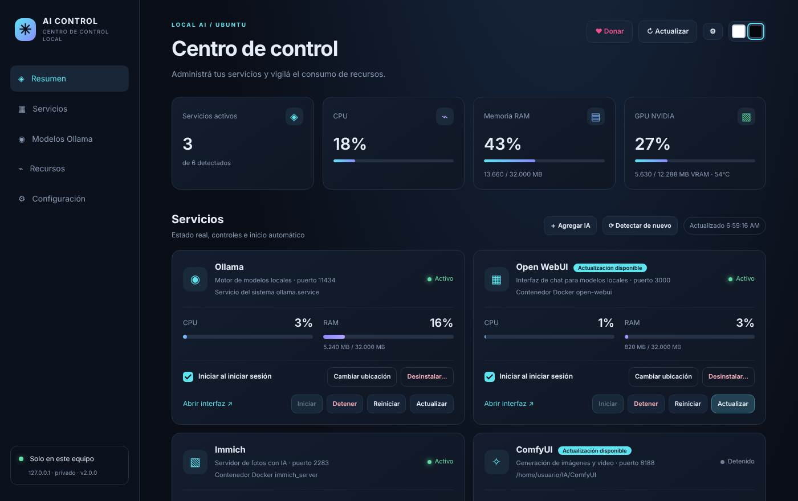
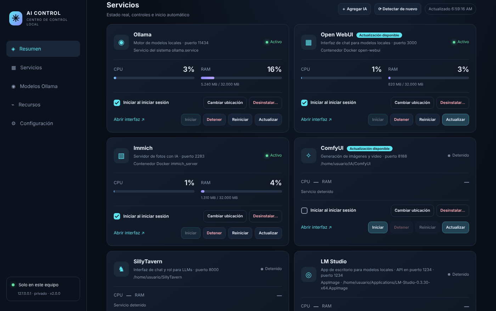
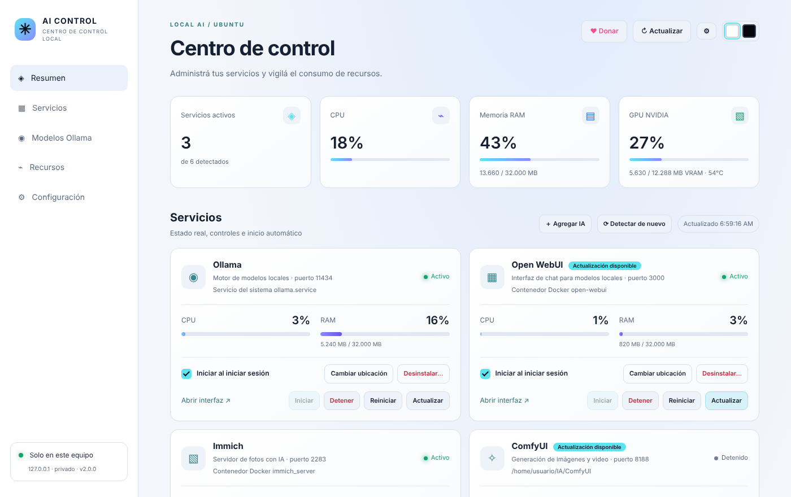
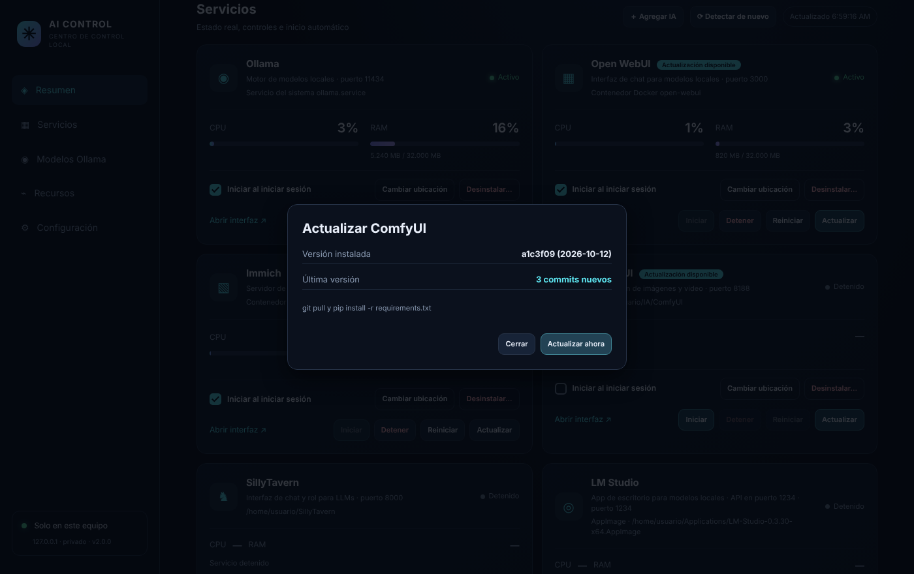
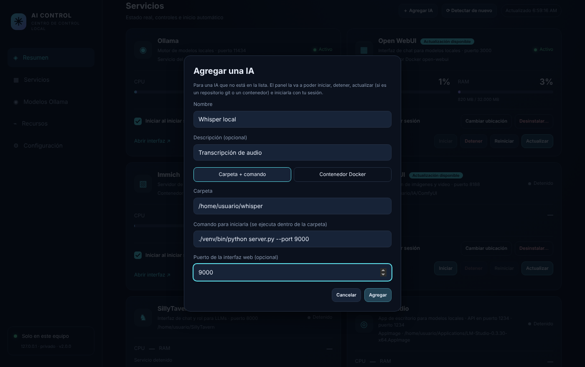
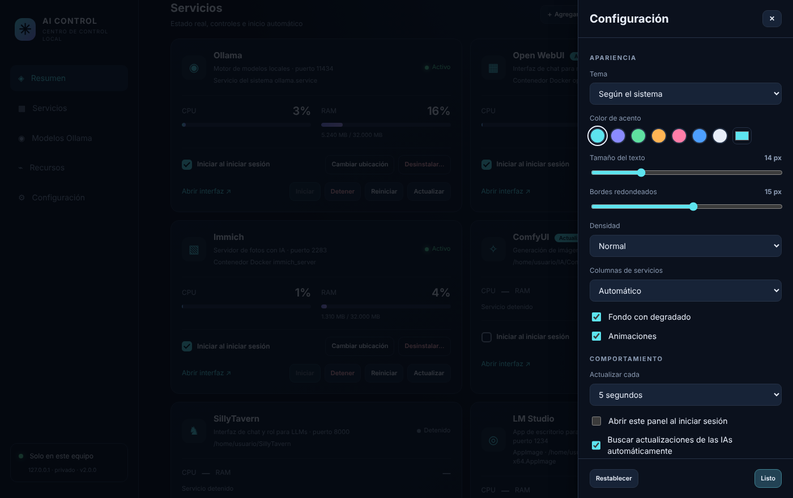
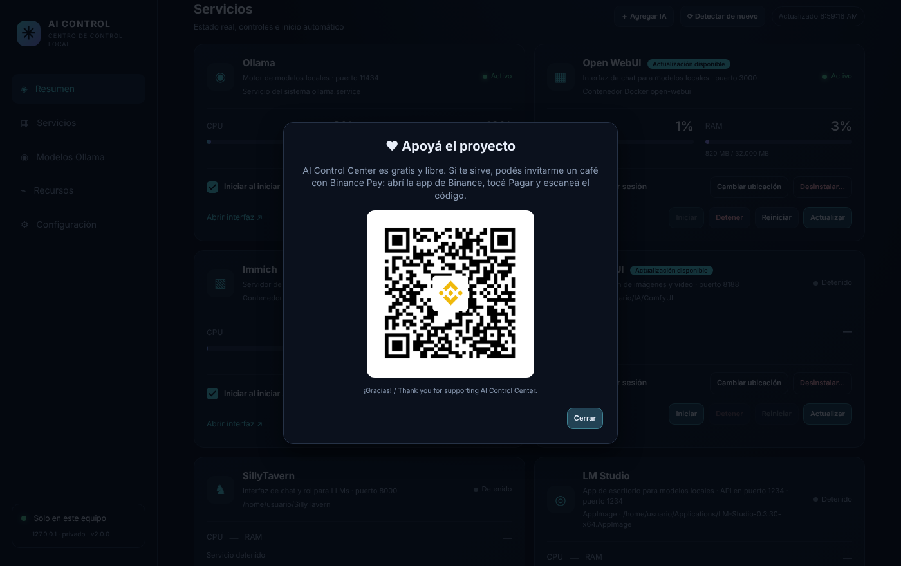

# AI Control Center for Ubuntu

[🇪🇸 Español](README.md) · 🇬🇧 **English**

A local panel to manage and update your local AI tools. It recognizes 19 of them (Ollama, Open WebUI, Immich, ComfyUI, LM Studio, Jan, GPT4All, LocalAI, AnythingLLM, Stable Diffusion WebUI and Forge, Fooocus, InvokeAI, text-generation-webui, SillyTavern, n8n, Flowise, LibreChat and Dify) and you can add any other. It installs as a `.deb` package or a snap, shows up in the applications menu and opens in its own window (with `ai-control-center --browser`, in the browser at `http://127.0.0.1:8765`).

The interface is in Spanish.

Developed by [devcibr](https://www.devcibr.com).



## Screenshots

| | |
|---|---|
|  |  |
| **Each AI tool in its card:** status, resource usage, autostart and Update button | **Light mode** with the two squares at the top right |
|  |  |
| **Update** with one click, seeing the installed and the new version | **Add an AI tool** that isn't on the list |
|  |  |
| **Settings** for colors, size, density and more | **Donate** with Binance Pay |

## Download

- **.deb:** get it from [Releases](https://github.com/cesarbarbozarueda/ai-control-center-ubuntu/releases/latest) and install it with a double click or with `sudo apt install ./ai-control-center_2.0.0_all.deb`.
- **App Center (snap):** coming soon.

## Features

- **Automatic detection** of each AI tool: system service, Docker container, executable in the PATH, folder (searched in the usual paths and in your home folder) or desktop app (AppImage, Flatpak or .deb). The ones not found go to a collapsible "Not detected" list.
- **Add an AI tool** ("＋ Agregar IA" button): for any AI tool not on the list, giving its folder and the command that starts it, or its Docker container, and an optional port. After that it is handled like the others.
- **Update**, one button per AI tool next to Start/Stop, with a progress window:
  - Ollama: official installer (asks for your password when installed system-wide).
  - Docker: image `pull` and container re-creation with the same settings (rolls back if it fails); with docker compose, `pull` + `up -d`.
  - Git folder: `git pull` and reinstall dependencies (pip or npm).
  - pip, npm and Flatpak packages with their own tool.
  - AppImage or .deb: opens the official page to download the new version.
- **"Update available" notice** on each card: the panel checks every 6 hours (can be turned off in Settings, or checked by hand).
- **Set the path by hand** when something isn't detected: folder, executable or Docker container, with an optional port.
- **Start at login**, one switch per AI tool:
  - System service (official Ollama): `systemctl enable/disable`.
  - Docker: restart policy `unless-stopped` or `no`.
  - Folder or executable: user service `~/.config/systemd/user/ai-<id>.service`.
- **Full uninstall**, with a preview of what gets deleted. The program is selected by default; data (models, volumes, generated images) only if you tick it. You must type the AI tool's name to confirm.
- **Own desktop window** (system GTK + WebKit); without WebKit it opens in the browser.
- **Light or dark theme** with the two squares at the top right (follows the system by default).
- **Settings panel**: accent color, text size, corners, density, columns, background, animations, refresh interval and opening the panel at login.
- CPU, RAM and NVIDIA GPU metrics, overall and per service, plus Ollama models loaded in memory.

## Compatibility

Ubuntu 20.04, 22.04, 24.04 and later (and derivatives such as Linux Mint 20+ or Pop!_OS). It uses the system Python with `python3-flask` and `python3-psutil` from apt, no virtual environment. Ubuntu 18.04 or older is not supported (Python too old).

## Install from source

```bash
./install.sh
```

Builds `dist/ai-control-center_<version>_all.deb`, installs it with apt (asks for your password) and opens the panel. If you had the previous version (user service `ai-control-center`), it disables it.

To only build the package, for example to share it:

```bash
packaging/build-deb.sh
sudo apt install ./dist/ai-control-center_2.0.0_all.deb
```

To test changes: `./deploy.sh` rebuilds, reinstalls, restarts the panel and shows the API status.

## Publishing and sharing (.deb and snap / App Center)

The full steps (in Spanish) are in [docs/PUBLICAR.md](docs/PUBLICAR.md): build both packages, upload the snap to the Snap Store so it shows up in the App Center (needs `classic` confinement, approved by Canonical), fill in the listing with the images in `packaging/store/` and share the `.deb`.

## Permissions

- The panel only listens on `127.0.0.1` and every action requires a token from the page, so other websites can't control it.
- For Ollama installed as a system service, the package installs three polkit helpers:
  - `aicc-service-helper`: start, stop, enable or disable `ollama.service`, without a password for the session user.
  - `aicc-uninstall-helper`: uninstall Ollama; always asks for the administrator password.
  - `aicc-update-helper`: update Ollama with its official installer; always asks for the administrator password.
  They only accept those fixed values; they don't run arbitrary commands.
- Docker requires your user to be in the `docker` group (`sudo usermod -aG docker $USER` and log in again).

## What is never deleted

- Folders mounted into containers (for example, the Immich photo library) or the docker compose folder.
- Files outside your home folder, except the system Ollama files through the helper.
- Files that belong to apt packages (you are told to remove them with apt).

## Files

- Settings: `~/.config/ai-control-center/config.json`
- Panel log: `~/.cache/ai-control-center/server.log`
- Installed code: `/usr/lib/ai-control-center/`

## Troubleshooting

```bash
ai-control-center --server          # run the panel in the foreground to see errors
systemctl --user status ai-comfyui  # user services created by the panel
systemctl status ollama
docker ps --format 'table {{.Names}}\t{{.Status}}\t{{.Ports}}'
```

## Uninstall the panel

```bash
./uninstall.sh
```

Removes the application. Your AI tools, models and data are left alone.

## Donations

If the project is useful to you, you can support it with the **♥ Donar** button in the panel (Binance Pay). The button only appears if `static/donate-binance.png` exists; the optional Binance Pay ID is set in `DONATE` in `app.py`.

## License

Copyright © 2026 devcibr. AI Control Center is free software: you can redistribute it and/or modify it under the terms of the GNU General Public License version 3 or, at your option, any later version. It comes with no warranty. See [LICENSE](LICENSE).
